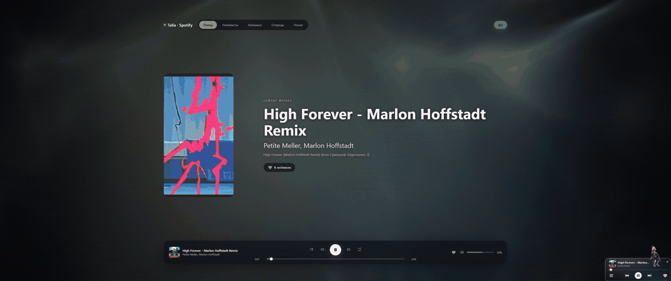
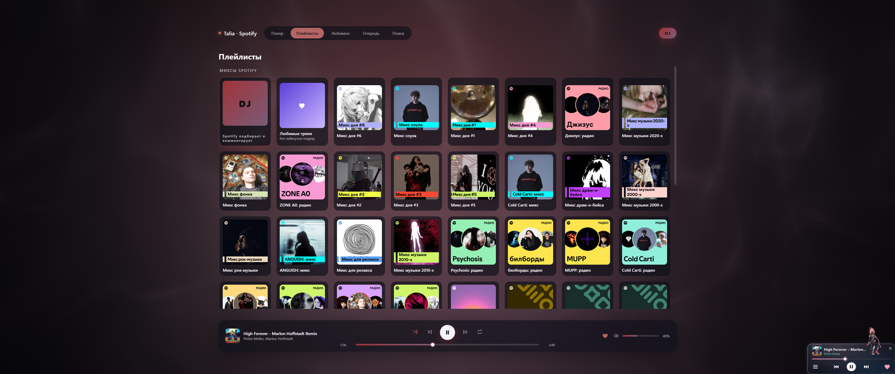
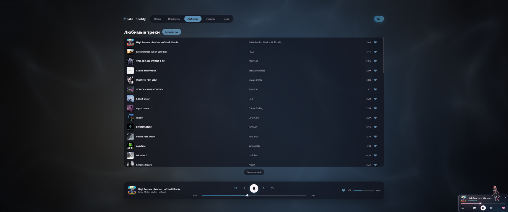
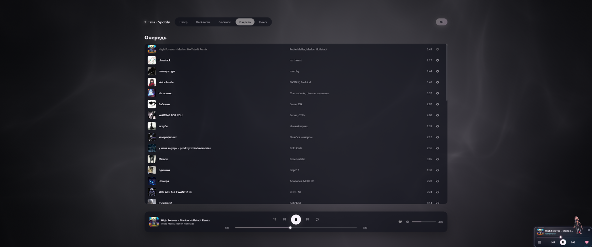
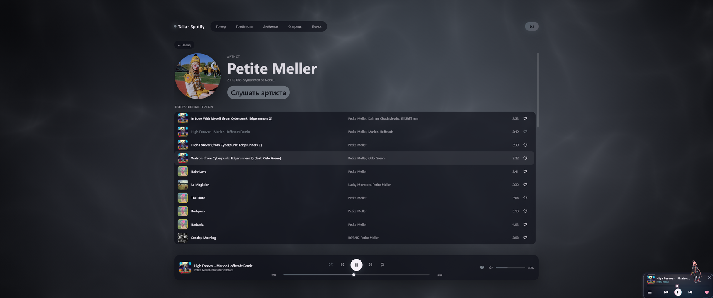

# Spotify Windows Wallpaper

Живые обои для Windows, из которых можно управлять Spotify целиком, и мини-плеер с анимированными персонажами.



| Плейлисты и миксы | Любимые треки |
|---|---|
|  |  |
| **Очередь** | **Страница артиста** |
|  |  |

## Персонажи

Сейчас в плеере два персонажа: Талия Янг из *Cyberpunk: Edgerunners 2* и Capri из [Capri Desktop](https://github.com/lachydotmcg/capri-desktop). Персонаж выбирается в меню ☰. У каждого своя тема плеера, свой шрифт, свои обои и свои танцы.

Дальше будем добавлять других культовых персонажей. Следующие в очереди Люси, Дэвид, Роман и Кинг.

## Что умеет

**Мини-плеер** висит поверх окон, его можно таскать мышью. На нём всегда сидит выбранный персонаж.

**Обои** ставятся за иконки рабочего стола на каждый монитор, и мониторы показывают одно и то же. С обоев доступно почти всё, что есть в самом Spotify:

- плей, пауза, перемотка, громкость, перемешивание, повтор, DJ;
- лайки и список любимых треков;
- плейлисты и миксы, которые Spotify собирает из рекомендаций;
- очередь воспроизведения;
- поиск по трекам, артистам и альбомам;
- страница артиста с популярными треками, релизами и похожими артистами, страница альбома. Имя артиста и альбом под названием трека кликаются.

Фон рисует шейдер в цветах обложки, он пульсирует под музыку. Режимов фона больше ста, режим меняется вместе с треком. Если у трека есть видеообложка Spotify (Canvas), она играет вместо обложки в своих пропорциях. Пока трек играет, маленькая фигурка персонажа танцует на полосе перемотки вместо ползунка.

Когда игра или окно на весь экран закрывает монитор, обои на нём встают на паузу и не грузят видеокарту.

## Как это работает

Данные и управление идут через [Spicetify](https://github.com/spicetify/cli): установщик кладёт Spicetify и подключает к приложению Spotify расширение `talia-bridge.js`. Расширение соединяется с плеером по WebSocket на `localhost` с токеном и отдаёт состояние, плейлисты, поиск и команды. Spotify Web API, ключи разработчика и вход через браузер не нужны. Если Spotify запущен без мода, мини-плеер работает через системную медиасессию Windows.

Обои это WebView2 за иконками рабочего стола, фон считается в WebGL. Звук для пульсации плеер снимает с системного выхода через WASAPI loopback, один поток на все мониторы.

## Установка

1. Скачай `TaliaSetup.exe` со страницы [Releases](../../releases).
2. Запусти. Права администратора не нужны: плеер встанет в `%LOCALAPPDATA%\Programs\TaliaPlayer`, Spicetify в `%LOCALAPPDATA%\spicetify`. Spotify при установке перезапустится.
3. В меню ☰ мини-плеера включи «Обои рабочего стола».

Нужны Windows 10 или 11, .NET Framework 4.8, WebView2 Runtime (в Windows 11 он уже есть) и Spotify для ПК, версия из Microsoft Store тоже подходит.

После обновления Spotify мод слетает. Тогда в меню ☰ → «Spicetify» нажми «Переприменить после обновления Spotify».

Удаление: «Установка и удаление программ» → Talia Player. Там же можно вернуть Spotify в исходное состояние.

## Потребление

Замеры на Ryzen 7 9800X3D, Radeon RX 9070 XT, 32 ГБ. Обои на двух мониторах (2560×1440 и 3440×1440), 60 кадров в секунду, играет музыка, фон анимируется.

| Процесс | Память (private) |
|---|---|
| Плеер (`TaliaPlayer.exe`) | 165–175 МБ |
| Рендер обоев, на каждый монитор | 60–70 МБ, между сборками мусора до 250 МБ |
| GPU-процесс WebView2 | 650–820 МБ, из них в рабочем наборе около 400 МБ |
| Всего | 1,1–1,5 ГБ |

Процессор: 3,5–8,8 % от всех потоков. Видеокарта: около 8 % 3D-движка на оба монитора.

На машине слабее больше всего заметна нагрузка на видеокарту от обоев на втором мониторе во время игры: монитор с игрой обои ставят на паузу, а соседний продолжают рисовать.

## Сборка из исходников

```powershell
.\build.ps1          # плеер в out\TaliaPlayer.exe
.\build-setup.ps1    # установщик в out\TaliaSetup.exe
```

Сборка идёт штатным `csc.exe` из .NET Framework 4.8, Visual Studio не нужна. Нужен объединённый `Windows.winmd` из Windows SDK, путь к нему можно передать через `-WindowsMetadata`.

Своих персонажей можно добавить в `assets/characters/<имя>`: каждая папка с `frames.tsv` считается танцем. Имена `sit`, `sit-arrive`, `sit-leave`, `sit-music`, `walk`, `arrive` и `leave` заняты под служебные клипы, `anchor.txt` задаёт точку бедра (`hip`) или ступней (`feet`).

## Благодарности

- [Capri Desktop](https://github.com/lachydotmcg/capri-desktop) от [Lachy](https://github.com/lachydotmcg). Из него взяты основа мини-плеера, работа с медиасессией Windows, тема и спрайты Capri. Арт и анимации Capri нарисовал её художник, который предпочитает оставаться неизвестным.
- [Spicetify](https://github.com/spicetify/cli): через него плеер получает данные и управляет Spotify. Установщик несёт неизменённый Spicetify 2.46.4.
- [Microsoft WebView2](https://developer.microsoft.com/microsoft-edge/webview2/): движок обоев.
- [Share Tech Mono](https://fonts.google.com/specimen/Share+Tech+Mono): шрифт темы Capri.
- Талия Янг из *Cyberpunk: Edgerunners 2* (CD PROJEKT RED и TRIGGER). Анимации Талии это фанатская перерисовка ключевых поз из танцевальных референсов, ссылки в [assets/Artwork-CREDITS.txt](assets/Artwork-CREDITS.txt).

## Лицензия

Код проекта распространяется по [PolyForm Noncommercial 1.0.0](LICENSE), как и Capri Desktop, на котором он основан: использовать, менять и распространять можно, продавать и использовать в коммерческих целях нельзя. При распространении сохраняй строки `Required Notice` из файла [LICENSE](LICENSE).

Сторонние части идут под своими лицензиями:

| Часть | Лицензия | Файл |
|---|---|---|
| Capri Desktop: код, арт, анимации | PolyForm Noncommercial 1.0.0 | [LICENSE-CAPRI.md](LICENSE-CAPRI.md) |
| Spicetify | LGPL-2.1, исходники: [spicetify/cli](https://github.com/spicetify/cli) | [LICENSE-SPICETIFY.txt](LICENSE-SPICETIFY.txt) |
| Microsoft.Web.WebView2 1.0.4314.35 | лицензия Microsoft WebView2 SDK | [lib/webview2/LICENSE-WebView2.txt](lib/webview2/LICENSE-WebView2.txt) |
| Share Tech Mono | SIL Open Font License 1.1 | [assets/upstream/fonts/OFL-ShareTechMono.txt](assets/upstream/fonts/OFL-ShareTechMono.txt) |

Персонаж Талии Янг и вселенная Cyberpunk принадлежат CD PROJEKT RED. Проект фанатский и некоммерческий, он не связан ни с CD PROJEKT RED, ни с TRIGGER, ни со Spotify. Spotify это товарный знак Spotify AB.
